<div align="center">

<a href="https://bithappens.dev/?from=github"></a>

<a href="https://bithappens.dev/?from=github"></a>

[](https://bithappens.dev/?from=github)
[](https://bithappens.dev/troubleshoot/?from=github)
[](https://bithappens.dev/tools/?from=github)
[](https://bithappens.dev/learn/?from=github)
[](https://bithappens.dev/study/?from=github)
[](https://bithappens.dev/changes/?from=github)

</div>


### 🎫 About

```yaml
ticket:   BH-0001
priority: P2 (it's always P2 until it's P1)
reporter: every IT tech, every shift
issue: >
  The fix lives in someone's head, a OneNote page,
  or reply #47 of a forum thread.
resolution:
  - write it down once, properly, with sources
  - turn the repetitive parts into tools that run in the browser
  - add a lab so you can practice breaking things safely
status:   in progress  # forever, on purpose
```

**Bit Happens** is a free, no-login IT reference built by a working infrastructure tech. Each guide starts from the symptom: a dead port, a 169.254 address, a bounced email, a failed Intune enrollment. It walks you to the fix with real commands, playbooks and links to the official docs behind every section. No accounts, no cookies, no ads.

<a href="https://bithappens.dev/?from=github"></a>

### 🧭 Start where it hurts

<table>
<tr>
<td width="33%" valign="top"><a href="https://bithappens.dev/troubleshoot/?from=github"></a><br/><b>Troubleshoot</b><br/><sub>Seven rings from the switch port outward to the fix.</sub></td>
<td width="33%" valign="top"><a href="https://bithappens.dev/tools/?from=github"></a><br/><b>Tools</b><br/><sub>Paste show output, an error, a config or a packet. Get a plain answer.</sub></td>
<td width="33%" valign="top"><a href="https://bithappens.dev/lab/?from=github"></a><br/><b>Switch Lab</b><br/><sub>A simulated Cisco IOS XE switch. Fix tickets with real commands.</sub></td>
</tr>
<tr>
<td width="33%" valign="top"><a href="https://bithappens.dev/lab/pc/?from=github"></a><br/><b>Help Desk Lab</b><br/><sub>A simulated Windows 11 PC: chat with the user, then fix it in PowerShell.</sub></td>
<td width="33%" valign="top"><a href="https://bithappens.dev/journey/?from=github"></a><br/><b>A packet's journey</b><br/><sub>One HTTPS request, wall jack to server and back, in 12 steps.</sub></td>
<td width="33%" valign="top"><a href="https://bithappens.dev/outages/?from=github"></a><br/><b>Outage replays</b><br/><sub>Meta, CrowdStrike, AWS and more, from their own postmortems.</sub></td>
</tr>
</table>

### 🧪 Ticket of the day

Pick an answer in your head, then click to check it.

<details>
<summary><b>1.</b> A laptop on a desk port shows <code>169.254.23.7</code>. The port light is green and the switch shows it <code>connected</code>. What failed?</summary>
<br/>

**DHCP.** A 169.254.x.x address is APIPA: the PC asked for an address and nobody answered. The cable and port are fine, so check the access VLAN, the gateway's `ip helper-address`, and whether the DHCP scope is full.
→ [Playbook: device has no IP](https://bithappens.dev/networking/playbooks/?from=github#pb-dhcp)

</details>

<details>
<summary><b>2.</b> Someone plugged a small desk switch into a wall jack and the port went dark. <code>show interfaces status</code> says <code>err-disabled</code>. What's the most likely reason?</summary>
<br/>

**BPDU Guard.** The desk switch sent spanning-tree BPDUs into an edge port, so the switch shut the port to prevent a loop. Remove the cause first, then recover the port. Bouncing it with the loop still there just takes it down again.
→ [Playbook: recover an err-disabled port](https://bithappens.dev/networking/playbooks/?from=github#pb-errdis)

</details>

<details>
<summary><b>3.</b> <code>ping 8.8.8.8</code> works, <code>ping google.com</code> fails. Where do you look?</summary>
<br/>

**DNS.** Routing to the internet is fine; name resolution isn't. Check which DNS servers the client got with `ipconfig /all`, then test them with `nslookup google.com <server>`.
→ [Windows: DNS](https://bithappens.dev/networking/end-devices/?from=github#win-dns)

</details>

<sub>Want more? There are 800+ practice questions for A+, Network+, Security+, CCNA, AWS, Azure and Google Cloud in <a href="https://bithappens.dev/study/?from=github">Study mode</a>. The answer shows as soon as you pick.</sub>

### 🛠️ What the guides cover

<a href="https://bithappens.dev/?from=github"></a>

<sub>Plus Cisco IOS XE, Aruba, Palo Alto, Fortinet, Intune, Exchange Online, SIP and Teams Phone, HL7 and medical devices, which don't have icons here.</sub>

**Built with:**  &nbsp; static pages on Cloudflare, no framework, works offline.

### 🌍 Read it in your language

<div align="center">

<a href="https://bithappens.dev/?from=github"> English</a> &nbsp;·&nbsp; <a href="https://bithappens.dev/es/?from=github"> Español</a> &nbsp;·&nbsp; <a href="https://bithappens.dev/fr/?from=github"> Français</a> &nbsp;·&nbsp; <a href="https://bithappens.dev/de/?from=github"> Deutsch</a> &nbsp;·&nbsp; <a href="https://bithappens.dev/ar/?from=github"> العربية</a>

</div>

### 📈 Uptime report

<div align="center">


</div>

<details>
<summary>🥚 <b>Easter eggs</b> (spoilers)</summary>
<br/>

- Type <kbd>↑</kbd> <kbd>↑</kbd> <kbd>↓</kbd> <kbd>↓</kbd> <kbd>←</kbd> <kbd>→</kbd> <kbd>←</kbd> <kbd>→</kbd> <kbd>B</kbd> <kbd>A</kbd> on the home page or any guide for rack mode.
- [Get lost on purpose](https://bithappens.dev/this-page-does-not-exist): the 404 page has a packet-catching game.
- Press <kbd>?</kbd> on the home page or any guide for the keyboard shortcuts.
- Try a bad day: [three tickets on one switch before lunch](https://bithappens.dev/lab/?from=github#bad).

</details>

<br/>

<a href="https://bithappens.dev/?from=github"></a>
